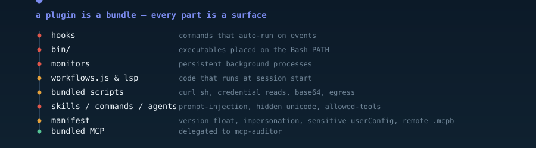

<p align="center">
  
</p>

<p align="center">
  
  
  
  
</p>

---

## What it is

A Claude Code **plugin is a filesystem bundle**, not a single MCP server — and when you enable it, many of its parts **execute** (hooks, `bin/` binaries, background monitors, `workflows/*.js`, LSP servers, bundled scripts) or **load into the model's context** (the markdown of its skills, commands, and agents). Reviewing the plugin's *code* misses most of this.

**plugin-auditor** statically inspects a plugin bundle and flags the risky parts in plain English. It is **read-only**: it never runs any hook, script, binary, workflow, monitor, or MCP server from the plugin, and never prints secret values (key names only).

> It sits alongside the sibling tools: **config-guard** gates/quarantines untrusted config; **plugin-auditor** deep-analyzes a plugin bundle; **mcp-auditor** audits the MCP tool metadata within it — plugin-auditor delegates to it.

## What it inspects

<p align="center">
  
</p>

- **Hooks** — commands that auto-run on Claude events (flags `curl|sh`, credential reads).
- **`bin/`** — executables placed on the Bash tool's PATH (Claude can run them as bare commands).
- **Monitors** — persistent background shell processes started at session start.
- **`workflows/*.js` & LSP servers** — code that runs.
- **Bundled scripts** — `curl|sh`, credential reads, base64, network egress.
- **skills / commands / agents markdown** — prompt-injection, hidden/zero-width unicode, credential refs, and over-broad `allowed-tools` grants.
- **Manifest provenance** — missing `version` (floats), Anthropic-name impersonation, sensitive `userConfig` fields, remote `.mcpb`/`.dxt` URLs, `..` path traversal.
- **Bundled MCP servers** — static provenance, and delegation to **mcp-auditor** for live tool-metadata.

## Install

A self-contained Claude Code **skill** — auto-discovered, **no configuration, no build step**:

```bash
git clone https://github.com/Claude-Booster/plugin-auditor.git ~/.claude/skills/plugin-auditor
```

The engine lives at [`scripts/plugin_auditor.py`](scripts/plugin_auditor.py). Then ask Claude *"audit this plugin"* / *"is this plugin safe?"*.

### Requirements

| Tool | Needed for | If missing |
|------|-----------|------------|
| **Python 3.10+** — standard library only, no `pip install` | Everything | The tool can't run |

## Usage

```bash
# audit one plugin bundle (or a directory of plugins — audits each)
python scripts/plugin_auditor.py audit "C:/path/to/plugin"

# also run mcp-auditor on any bundled MCP server
python scripts/plugin_auditor.py audit "C:/path/to/plugin" --with-mcp
```

Exit code is `1` when any HIGH finding exists, else `0`. Without `--with-mcp`, bundled MCP servers get static provenance checks plus a note to run mcp-auditor (nothing is spawned).

## Reading the report

Leads with a one-line verdict + per-severity counts, then findings grouped HIGH→INFO, each naming the plugin → component → "what to check" with an evidence snippet. A footer states it's a **static** scan — it executed nothing, and runtime behavior / live MCP tool-metadata aren't covered.

## Where things live

| Thing | Location |
|-------|----------|
| The engine | `scripts/plugin_auditor.py` (inside this skill) |
| Tests | `scripts/test_plugin_auditor.py` |

## Safety

- **Read-only.** It only reads files and pattern-matches — it never executes hooks, scripts, binaries, workflows, monitors, or MCP servers from the plugin.
- **Secret values never printed** — sensitive `userConfig`/`env` surfaces show key names only.
- The only thing it may spawn is the sibling **mcp-auditor**, and only with `--with-mcp`.

## Contributing

To *use* the skill you need nothing below. For changes, run the tests from the skill folder:

```bash
cd scripts && python -m unittest -v
```
