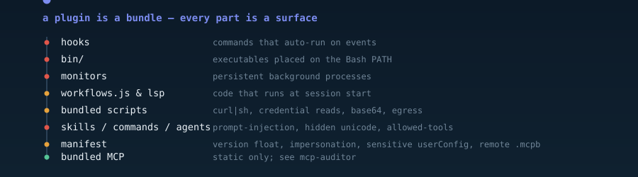

<p align="center">
  
</p>

<p align="center">
  
  
  
  
</p>

---

## What it is

A Claude Code **plugin is a filesystem bundle**, not a single MCP server — and when you enable it, many of its parts **execute** (hooks, `bin/` binaries, background monitors, `workflows/*.js`, LSP servers, bundled scripts) or **load into the model's context** (the markdown of its skills, commands, and agents). Reviewing the plugin's *code* misses most of this.

**plugin-auditor** statically inspects a plugin bundle and flags the risky parts in plain English. It is **read-only**: it never runs any hook, script, binary, workflow, monitor, or MCP server from the plugin, never spawns another program, makes no network calls, and never prints sensitive `userConfig`/`env` values (key names only). Command and URL evidence is shown with likely secrets (tokens, passwords, Authorization/Bearer, URL credentials, query values) masked on a best-effort basis.

> It sits alongside the sibling tools: **config-guard** gates/quarantines untrusted config; **plugin-auditor** deep-analyzes a plugin bundle; **mcp-auditor** is a separate skill that audits live MCP tool metadata (run it yourself, after this report).

## What it inspects

<p align="center">
  
</p>

- **Hooks** — commands that auto-run on Claude events (flags `curl|sh`, credential reads).
- **`bin/`** — executables placed on the Bash tool's PATH (Claude can run them as bare commands).
- **Monitors** — persistent background shell processes started at session start.
- **`workflows/*.js` & LSP servers** — code that runs.
- **Bundled scripts** — `curl|sh`, credential reads, base64, network egress.
- **skills / commands / agents markdown** — prompt-injection, hidden/zero-width unicode, credential refs, and over-broad `allowed-tools` grants.
- **Manifest provenance** — missing `version` (floats), Anthropic-name impersonation, sensitive `userConfig` fields, remote `.mcpb`/`.dxt` URLs, `..` path traversal.
- **Bundled MCP servers** — static provenance checks only; they are never started by this tool (the report recommends reviewing first, then running the separate **mcp-auditor**).

## Install

A self-contained Claude Code **skill** — auto-discovered, **no configuration, no build step**:

```bash
git clone https://github.com/Claude-Booster/plugin-auditor.git ~/.claude/skills/plugin-auditor
```

The engine lives at [`scripts/plugin_auditor.py`](scripts/plugin_auditor.py). Then ask Claude *"audit this plugin"* / *"is this plugin safe?"*. Not for auditing a single live MCP server (use **mcp-auditor**), gating repo-shipped config when a repo is first opened (use **config-guard**), or general questions about plugins.

### Requirements

| Tool | Needed for | If missing |
|------|-----------|------------|
| **Python 3.10+** — standard library only, no `pip install` | Everything | The tool can't run |

## Usage

```bash
# audit one plugin bundle (or a directory of plugins — audits each)
python scripts/plugin_auditor.py audit "C:/path/to/plugin"
```

Exit code is `1` when any HIGH finding exists, else `0` (`2` if the path does not exist; the engine also exits `1` with a message if `scripts/net_patterns.json` is missing or invalid). Bundled MCP servers get static provenance checks plus a note to run the separate mcp-auditor (nothing is spawned).

## Reading the report

Leads with a one-line verdict + per-severity counts, then findings grouped HIGH→INFO, each naming the plugin → component → "what to check" with an evidence snippet. A footer states it's a **static** scan — it executed nothing, and runtime behavior / live MCP tool-metadata aren't covered.

## Where things live

| Thing | Location |
|-------|----------|
| The engine | `scripts/plugin_auditor.py` (inside this skill) |
| Rule data (network/exec patterns) | `scripts/net_patterns.json` (must stay next to the engine; see note below) |
| Tests | `scripts/test_plugin_auditor.py` |

> **Why a data file?** The network/exec detection patterns (`curl`, `wget`, `child_process`, `fetch`, ...) live in `scripts/net_patterns.json` instead of inside the engine so that the engine itself carries no network-looking literals, which static scanners otherwise mistake for capabilities. The strings are unchanged and in plain text; keep the file with the engine and review it like code, because editing it changes what the auditor detects.

## Safety

- **Read-only.** It only reads files and pattern-matches — it never executes hooks, scripts, binaries, workflows, monitors, or MCP servers from the plugin, never spawns another program, and makes no network calls.
- **Contained reads** — symlinks and paths resolving outside the plugin (e.g. `..` in manifest entries) are never read; they are reported as findings. The credential and network patterns only match text inside the audited plugin.
- **Secrets masked** — sensitive `userConfig`/`env` surfaces show key names only; command/URL evidence masks likely secrets (best-effort, heuristic — not a guarantee).
- **No live MCP execution.** An earlier opt-in flag that delegated to mcp-auditor was removed: an auditor for untrusted plugins should not start their MCP servers. Run the separate mcp-auditor yourself, only after reviewing this report.

## Scanning this skill with SkillSpector
`.skillspector-baseline.yaml` records the remaining by-design findings, each with a stated reason; they are all in files that are not part of the engine or assets (the test fixtures, the shared commit-guard hook scripts and its workflow). The engine, its rule data, the docs and the assets scan clean without it. It is evidence-bound: changing a flagged file re-activates its findings until they are reviewed again (regenerate with `skillspector baseline`). SkillSpector only applies it when told to, so scan with:

```
skillspector scan . --no-llm --baseline .skillspector-baseline.yaml
```

Submitting only the engine, its rule data, the docs and the assets? Keep the folder layout (`scripts/`, `assets/`) so the references in `SKILL.md` resolve, and include `scripts/net_patterns.json`.

## Contributing

To *use* the skill you need nothing below. For changes, run the tests from the skill folder:

```bash
cd scripts && python -m unittest -v
```
